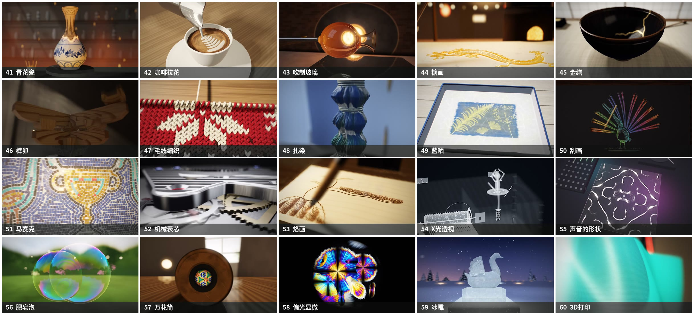

# 再来 20 种 · 说一句话就出片


## 3 步用起来

1. **下载**：点这个页面上绿色的 **Code** 按钮 → **Download ZIP**，下载后右键 → **全部解压**。
2. **双击安装**：Windows 双击 **`安装-Windows.bat`**（Mac 双击 `安装-Mac.command`，**Mac 版未实测**，见下面说明）。它会自动装好需要的东西，第一次大约 5–20 分钟，看网速。装过的会跳过，可以反复双击。如果弹出蓝色的“Windows 已保护你的电脑”或安全警告，点 **更多信息 → 仍要运行**（文件是从网上下载的，Windows 都会这样问一句）。
3. **说一句话**：打开 [Claude Code](https://claude.com/claude-code)（**装之前就开着的话，先关掉再打开一次**，它才能看到新装的说明），直接说：
   - 「帮我把万花筒那条做出来」
   - 「20 种全部渲染」
   - 「把冰雕的灯改成暖黄色」

   AI 会自己找到这个包、出片，告诉你片子放在哪（包里的 `out` 文件夹）。

   **最好在这个解压出来的文件夹里打开 Claude Code**（在文件夹里打开终端，输入 `claude`；或者在 Claude Code 里选这个文件夹）。这样它一打开就能读到包里的说明，找文件、跑命令时弹出来让你点“允许”的确认也少一些。弹出确认时看一眼，是在这个文件夹里出片、出图的命令就可以点允许。

> **不想等渲染？** 20 条做好的成片可以直接下载：[Releases → v1.0](https://github.com/xiaoxiong20xx-code/sy-style-more20/releases/tag/v1.0) 里的 `more-styles-20.zip`（约 510 MB，解压后是 `41-青花瓷.mp4` … `60-3D打印.mp4`）。

---

20 种手艺、材料和科学现象，每条 10 秒纯画面（1920×1080，30fps，带配乐音效，**画面里没有文字和署名，拿去就能用**）。没有用任何视频素材、模板或版权音乐：每一帧都由代码算出来，配乐和音效也由代码合成。



| 编号 | 风格 | 画面 |
|---|---|---|
| 41 | **青花瓷** BLUE & WHITE PORCELAIN | 毛笔在转台上的素坯瓶上一拍一笔勾出缠枝莲，窑火一亮，灰黑变成青花。 |
| 42 | **咖啡拉花** LATTE ART | 奶缸往浓缩咖啡里注奶，手腕一晃一晃推出叶片，最后切出一朵郁金香。 |
| 43 | **吹制玻璃** GLASSBLOWING | 吹管在工作椅上滚料、吹泡、撑出喇叭口花瓶，火色退去瓶口先变透明。 |
| 44 | **糖画** SUGAR PAINTING | 夜市糖画摊，铜勺在大理石上一笔浇出一条龙，背光一亮透出琥珀色。 |
| 45 | **金缮** KINTSUGI | 碎成六片的黑釉茶碗按拍飞回合拢，金漆流过裂缝把整只碗连起来。 |
| 46 | **榫卯** WOOD JOINERY | 窗棂光里刨花卷起，一组斗拱按拍落位咬合，最后一根咔一声锁死。 |
| 47 | **毛线编织** FAIR ISLE KNITTING | 微距下棒针一针针织着奶白莓红的毛线，拉远是一行行织出的雪花图案。 |
| 48 | **扎染** SHIBORI TIE-DYE | 扎好的布团浸进靛蓝缸，见了空气变深蓝，绳子弹开抖出一圈圈白环。 |
| 49 | **蓝晒** CYANOTYPE | 压花标本放在感光纸上晒太阳，放进水盘，普鲁士蓝涌开、叶脉浮出来。 |
| 50 | **刮画** SCRATCHBOARD | 竹笔在黑蜡纸上刮出彩虹色的孔雀，尾屏四拍四次炸开。 |
| 51 | **马赛克** MOSAIC | 镊子把石块压进湿灰泥，拼出孔雀对饮金杯，油灯走过金块一粒粒闪光。 |
| 52 | **机械表芯** WATCH MOVEMENT | 微距表芯里摆轮按拍嘀嗒，镜头贴着齿轮系穿过，止秒杆让一切停住。 |
| 53 | **烙画** PYROGRAPHY | 夜里台灯下，电烙笔在椴木板上冒着烟，一笔笔烧出一棵迎客松。 |
| 54 | **X光透视** X-RAY | 实时 X 光下八音盒慢慢转，盒盖一弹，芭蕾小人随弹簧立起来。 |
| 55 | **声音的形状** SHAPE OF SOUND | Live House 的 DJ 台上，钢板上的细沙随音乐每拍跳成一种新花纹。 |
| 56 | **肥皂泡** SOAP BUBBLES | 阳光花园里吹出透明泡泡，两只相碰合成一对，中间长出一层彩膜。 |
| 57 | **万花筒** KALEIDOSCOPE | 目镜里碎玻璃每拍翻成一朵新花，镜头退出来是桌上的黄铜万花筒。 |
| 58 | **偏光显微** POLARIZED MICROSCOPY | 偏光显微镜的黑色视野里，晶体一拍一个长出来，一边长一边变色。 |
| 59 | **冰雕** ICE CARVING | 黄昏雪地里冰凿削出一只天鹅，底座灯一亮，整只通体透亮。 |
| 60 | **3D打印** 3D PRINTING | 台灯下的打印机延时拍，喷头一层层堆出一只扭纹花瓶。 |

作者：**肖雄 / XIAOXIONG** · 开源协议 MIT（可以免费用、改、商用；转载或二次分发代码请保留作者署名）

**同一个作者的其他包**（用法一样，都是“双击安装 → 说一句话”）：

- 上一批 21–40（油画厚涂、粉笔黑板、字符画、彩色玻璃窗……）：[sy-style-new20](https://github.com/xiaoxiong20xx-code/sy-style-new20)
- 100 条视频的总仓库（第一期 20 + 第二期 20 + 行业示例 60）：[sy-style-100](https://github.com/xiaoxiong20xx-code/sy-style-100)

## 要等多久

| 风格 | 有显卡 | 没有显卡：正式片 | 没有显卡：草稿 |
|---|---|---|---|
| 41 青花瓷 | 约 8 分钟 | 约 11.8 小时 | 约 12 分钟 |
| 42 咖啡拉花 | 约 4 分钟 | 约 11.2 小时 | 约 21 分钟 |
| 43 吹制玻璃 | 约 5 分钟 | 约 6.8 小时 | 约 11 分钟 |
| 44 糖画 | 约 9 分钟 | 约 2.1 天 | 约 39 分钟 |
| 45 金缮 | 约 7 分钟 | 约 27.5 小时 | 约 52 分钟 |
| 46 榫卯 | 约 7 分钟 | 约 2.3 天 | 约 52 分钟 |
| 47 毛线编织 | 约 11 分钟 | 约 4.4 天 | 约 1.9 小时 |
| 48 扎染 | 约 6 分钟 | 约 34.4 小时 | 约 44 分钟 |
| 49 蓝晒 | 约 4 分钟 | 约 6.2 小时 | 约 12 分钟 |
| 50 刮画 | 约 8 分钟 | 约 36 分钟 | 约 1 分钟 |
| 51 马赛克 | 约 19 分钟 | 约 2.3 天 | 约 25 分钟 |
| 52 机械表芯 | 约 72 分钟 | 约 5.6 天 | 约 31 分钟 |
| 53 烙画 | 约 50 分钟 | 约 3.3 天 | 约 21 分钟 |
| 54 X光透视 | 约 18 分钟 | 出不了（软件渲染一张图一个多小时都算不完，请下载成片） | 出不了（软件渲染一张图一个多小时都算不完，请下载成片） |
| 55 声音的形状 | 约 7 分钟 | 约 4.1 小时 | 约 11 分钟 |
| 56 肥皂泡 | 约 6 分钟 | 约 7.8 小时 | 约 10 分钟 |
| 57 万花筒 | 约 4 分钟 | 约 6.1 小时 | 约 12 分钟 |
| 58 偏光显微 | 约 3 分钟 | 约 68 分钟 | 约 3 分钟 |
| 59 冰雕 | 约 8 分钟 | 约 2.2 天 | 约 80 分钟 |
| 60 3D打印 | 约 12 分钟 | 约 2.6 天 | 约 39 分钟 |
| **20 条全部** | **约 4.5 小时** | **约 29.7 天**（不含 54） | **约 9.8 小时**（不含 54） |

都是估算。“有显卡”是在 RTX 4060 Ti 台式机上测的：52、54、55 按包里的流程完整出片实测，其余每条实测 1 秒画面再按全片子帧数推算，加上配声音和合成；“没有显卡”是 12 线程 CPU 用软件渲染实测两帧全分辨率画面再推算的，草稿 = 半分辨率、不加运动模糊。52 机械表芯最久：表芯微距要很多运动模糊子帧（快的那几秒每帧 112 张），换来的是拖影顺滑不出台阶。

**没有独立显卡的电脑**：能出片（54 X光透视除外：软件渲染一张图一个多小时都算不完，只能下载成片），但正式片一条要几个小时到几天，所以 make.js 不会自己开始，会先提示你。建议直接去 Releases 下载做好的成片；改过的风格先出草稿（`--draft`）看效果，满意了再挑着出正式片（`--cpu`，可以过夜跑，中断了能接着做）。核显、笔记本显卡介于两者之间、差别很大，以出片时显示的“预计还要”为准。

- 第一次出片前，AI 会先告诉你大概要多久。中途关掉也没关系，再说一次「继续做」（或再运行同一条命令）会从停下的地方接着做。
- 想先看效果：说「先给我看一张万花筒第 5 秒的图」，几秒到一分钟就出来。

## 电脑要求

| 项目 | 要求 |
|---|---|
| 系统 | Windows 10 / 11（64 位）。Mac 版安装脚本已写好但**作者没有实测**。 |
| 硬盘 | 装好约 2 GB（浏览器、Python、ffmpeg 等）；出片时每条临时占几百 MB 到 1 GB 多，做完自动删掉；20 条成片一共约 510 MB。 |
| 显卡 | 最好有独立显卡（N 卡 / A 卡）：一条几分钟到一个多小时（52、53 最久）。没有也能出图、出草稿，但正式片一条要几个小时到几天（见上表），不想等就直接下载成片。 |
| 网络 | 第一次安装要下载约 0.5–1 GB（浏览器、ffmpeg 等；已经装过的不再下载）。渲染组件、浏览器、numpy 下载失败时会自动换国内镜像再试一次。 |
| AI 助手 | 主要按 Claude Code 写的说明书；Codex、Cursor 等能读 `AGENTS.md` 的助手也可以，在这个文件夹里打开它们就行。 |

## 常见问题

**双击 `安装-Windows.bat` 一闪就没了 / 提示要和整个包放在一起？**
先把下载的 zip「全部解压」，再进解压出来的文件夹双击。不要在压缩包里直接双击。

**双击后弹出“无法验证发布者”或蓝色的“Windows 已保护你的电脑”？**
因为文件是从网上下载的。蓝色窗口点 **更多信息 → 仍要运行**；小的安全警告窗口点“运行”。

**安装时弹出“是否允许此应用更改设备”？**
那是在装 Node.js，点“是”。

**已经装过上一批 sy-style-new20，还要再装一遍吗？**
要双击一次这个包的安装文件，但很快：Node.js、Python、ffmpeg、浏览器都已经有了，会自动跳过，只装这个包自己的渲染组件和 AI 说明书。两个包可以同时留着，互不影响。

**装完了，Claude Code 却好像不知道这个包？**
把 Claude Code 完全关掉再打开（装之前开着的窗口看不到新装的说明）。还不行就再双击一次安装文件。

**装完说找不到 ffmpeg / Python？**
关掉所有终端窗口和 Claude Code，重新打开再试。还不行就再双击一次安装文件。

**Mac 双击 `安装-Mac.command` 提示“无法打开”？**
在访达里按住 control 点它 → 打开 → 再点“打开”。或者打开“终端”，输入 `bash `（后面有个空格），把文件拖进去，回车。Mac 上要先装 Homebrew（脚本会告诉你怎么装，这一步要输开机密码，得你自己来）。

**AI 说“没检测到能用的显卡”或“显卡渲染没成功”？**
没显卡时正式片一条要等几个小时到几天，所以它会先停下来问你：直接下载做好的成片、先出草稿看效果，还是过夜慢慢渲。选一个告诉它就行。Windows 上显卡接口偶尔出问题时，它会自己换一种接口重试。

**片子在哪？**
包里的 `out` 文件夹，文件名是「编号-中文名.mp4」，比如 `out/57-万花筒.mp4`。

**能改成我想要的样子吗？**
能。直接跟 AI 说，比如「把冰雕的灯改成暖黄色」「青花瓷的光偏冷一点」「肥皂泡的颜色淡一点」。20 条里有 17 条已经做好了“光色旋钮”，改光色很稳。AI 会先把原版备份一份（`index.原版.html`），改好后出几张图给你看，你满意了再出正式片。改坏了说一句「换回原版」就行。

**不用 AI，自己敲命令行不行？**
行。在这个文件夹里打开终端：

```
node make.js check          检查装齐没有
node make.js list           20 种的编号和名字
node make.js still 57 5     出一张图（57 号第 5 秒）
node make.js style 57       出 10 秒成片 → out/57-万花筒.mp4
node make.js style all      20 种全部出片
```

**硬盘满了？**
`node make.js clean` 删掉没做完的临时帧；成片不受影响。

## 文件夹里都是什么

```
安装-Windows.bat / 安装-Mac.command   一键安装
make.js        唯一入口：检查、出图、出片（所有提示都是中文）
render.js      逐帧渲染器：无头浏览器一帧一帧截图，多张子帧叠出运动模糊（支持柔和快门、分段加子帧）；字体、显卡都内置处理
styles/        20 个风格：每个一个 index.html（画面）+ music.py（配乐音效）+ render.args（渲染参数）
lib/           画面公共库（时间轴、WebGL、光线步进 3D、连续镜头、笔触、手艺材质、马赛克、烙画）
audio/         配乐音效合成（Python）
fonts/         渲染用的字体和许可证（不装进系统）
skills/        给 AI 看的说明书（安装时会装到 Claude Code 里）
AGENTS.md      给 Codex / Cursor 等 AI 看的说明
```

## 致谢

字体：思源黑体 Noto Sans CJK SC（Adobe / Google，OFL）、Inter（OFL）、DejaVu Sans Mono、TeX Gyre Heros Cn（GUST 字体协议），许可证见 [fonts/LICENSES.md](fonts/LICENSES.md)。渲染用 [Playwright](https://playwright.dev) + Chromium，视频合成用 [FFmpeg](https://ffmpeg.org)。

欢迎关注作者 **肖雄 XIAOXIONG**，分享你用它做出来的作品。
